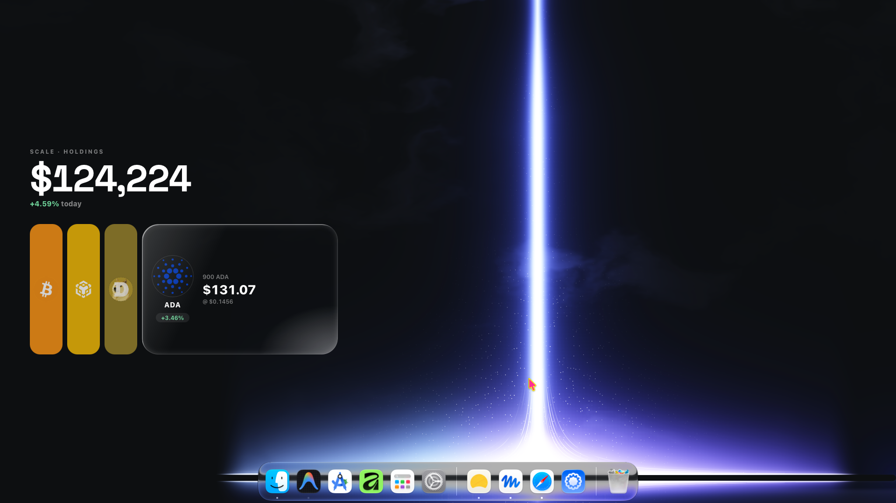
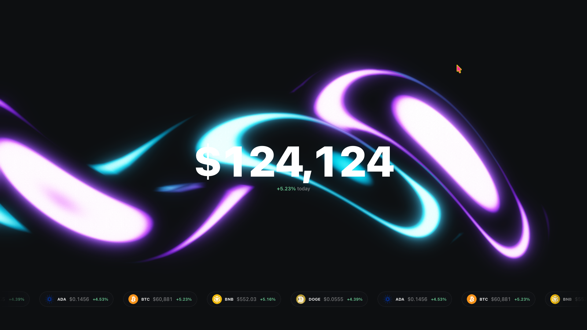

# Momo

> Your portfolio, on your desktop.

A live macOS wallpaper that turns your crypto holdings into ambient light. Up, the room glows green. Down, it cools to red. You learn how your day is going in half a second, without opening anything.



## Download

**macOS 13+** — no build needed:

<p align="center">
  <a href="https://github.com/suvo-sos/momo/releases/tag/v0.1.1">
    
  </a>
</p>

<p align="center">
  <a href="https://github.com/suvo-sos/momo/releases/download/v0.1.1/Momo.dmg">⬇️ Download Momo.dmg</a> ·
  <a href="https://github.com/suvo-sos/momo/releases/download/v0.1.1/Momo.zip">⬇️ Download Momo.zip</a>
</p>

1. Open `Momo.dmg`, drag **Momo.app** into **Applications**, run it. A `▞` appears in your menu bar.
2. First open is blocked (not notarized) — fix it with: `xattr -d com.apple.quarantine /Applications/Momo.app`

Works out of the box with Momo's built-in CoinMarketCap key. Prefer to build it? See [Quick start](#quick-start).

<p align="center">
  <a href="https://www.apple.com/macos/"></a>
  <a href="https://www.swift.org/"></a>
  <a href="https://coinmarketcap.com/api/"></a>
  <a href="LICENSE"></a>
  <a href="https://dorahacks.io/"></a>
</p>

Built for **Build with CMC: API Hackathon, Round 2** (DoraHacks, 2026) — Track: **Data and Visualisation**.

---

## Screenshots

| Ledger | Scale |
|---|---|
|  |  |

| Dashboard | Minimal |
|---|---|
|  |  |

---

## Themes

4 backgrounds × 5 contents, mixed freely, with a live preview in Settings.

**Backgrounds:** Chrome Arcs, Anodized Ink, Laser Flow, Plasma Wave. Anodized Ink re-tints with the market — green up, red down.

**Contents:** Minimal, Dashboard, Focus, Ledger, Scale. Ledger is a curved gallery that steers toward your cursor; Scale is an accordion that opens the coin under your cursor.

---

## Quick start

```bash
git clone https://github.com/suvo-sos/momo.git
cd momo
./build.sh
open Momo.app
```

## The API

| Endpoint | Use | Cost |
|---|---|---|
| `v1/cryptocurrency/quotes/latest` | Price and 24h % per holding | 1 credit / request |
| `v1/cryptocurrency/listings/latest` | Coin list, logos, market data | 1 credit / request |

~1,440 credits/day at the 60s default — a free Startup key (15,000/month) lasts ~10 days; set a 5-minute refresh to last the month.

```http
GET https://pro-api.coinmarketcap.com/v1/cryptocurrency/quotes/latest?symbol=BTC,ETH,SOL&convert=USD
X-CMC_PRO_API_KEY: <your key>
```

```json
{ "data": { "BTC": { "id": 1, "symbol": "BTC",
  "quote": { "USD": { "price": 91204.0, "percent_change_24h": 2.14 } } } },
  "status": { "error_code": 0, "credit_count": 1 } }
```

---

MIT © 2026 Suvo — free to use, modify, and share. See [LICENSE](LICENSE).
