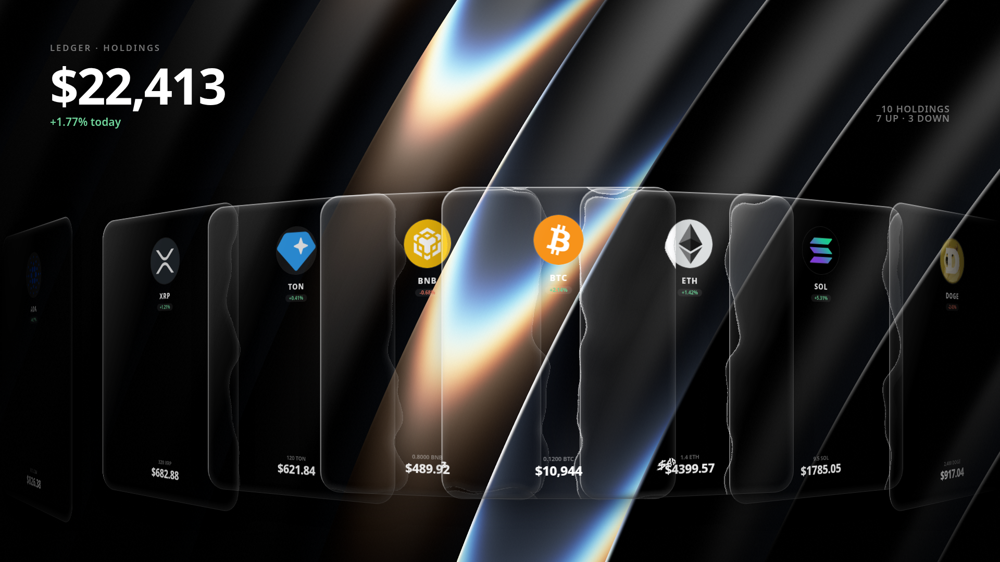
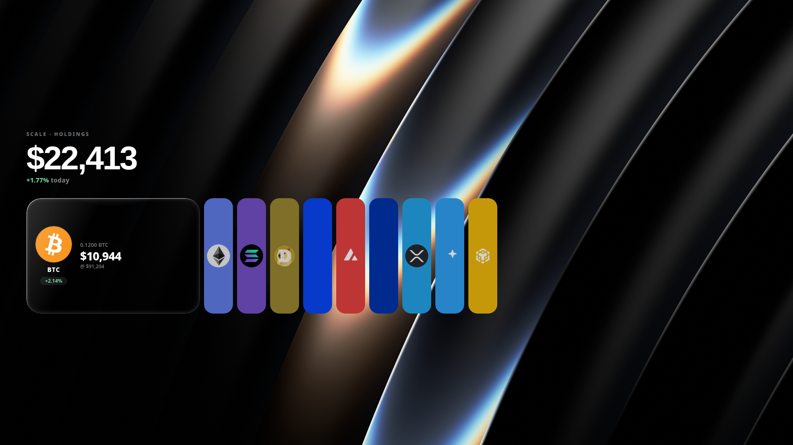
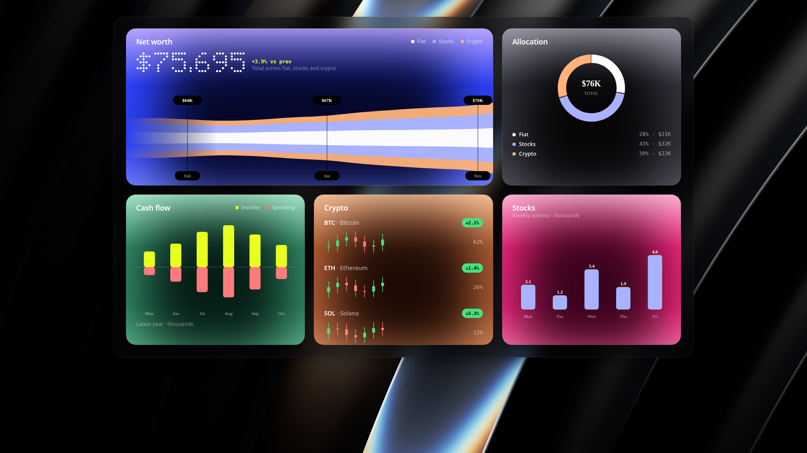

# Momo

> Your portfolio, on your desktop.

A live macOS wallpaper that turns your crypto holdings into ambient light. One number, one mood — always visible, never in the way.

[](https://www.apple.com/macos/)
[](https://www.swift.org/)
[](https://coinmarketcap.com/api/)
[](LICENSE)
[](https://dorahacks.io/)

Built for **Build with CMC: API Hackathon, Round 2** (DoraHacks, 2026) — Track: **Data and Visualisation**.

## Download

**macOS 13+** — get the app, no build needed:

### [⬇ Download Momo for Mac (.dmg)](https://github.com/suvo-sos/momo/releases/latest)

1. Open `Momo.dmg` and drag **Momo.app** into **Applications**.
2. Run it. A `▞` appears in your menu bar — that's the whole UI.

> **macOS will block it the first time.** Momo is a hackathon build, not notarized, so Gatekeeper calls it an "unidentified developer". One command fixes it:
>
> ```bash
> xattr -d com.apple.quarantine /Applications/Momo.app
> ```
>
> Then open Momo again. (Or right-click Momo.app → **Open** → **Open**.)

No account, no setup. It works out of the box with Momo's built-in CoinMarketCap key. If that key runs out of credits, paste your own free key into **Settings → Your own CMC key**.

Prefer to build it yourself? See [Quick start](#quick-start) below.

---

## What it is

Every other portfolio app puts numbers in a window you have to open. Momo puts one number on the one surface that is always visible: your desktop.

It polls the CoinMarketCap API for your holdings, then paints your wallpaper with the state of your portfolio. Up, and the room glows green. Down, and it cools to red. You learn how your day is going in half a second, without opening anything.

- **Live.** Prices refresh every 60 seconds from CoinMarketCap.
- **Ambient, not a dashboard.** No charts to read, no window to manage. The desktop itself carries the mood.
- **Yours.** Pick a background and a content style; they mix freely. Your holdings, your currency, your key.

---

## Screenshots

| Ledger — curved gallery | Scale — expanding accordion |
|---|---|
|  |  |

| Dashboard — Finance Bento | Settings |
|---|---|
|  |  |

*Screenshots use demo data.*

---

## Themes

Four backgrounds × five contents. Mix any background with any content — one live preview in Settings shows the combination before you commit.

| Background | What it is |
|---|---|
| **Chrome Arcs** | Liquid chrome arcs sweeping across black |
| **Anodized Ink** | Ink that re-tints with the market — green when you're up, red when you're down |
| **Laser Flow** | Thin laser lines in motion |
| **Plasma Wave** | A slow plasma wash |

| Content | What it shows |
|---|---|
| **Minimal** | One number: your total, and today's change |
| **Dashboard** | Finance Bento — net worth, allocation, cash flow, crypto, stocks |
| **Focus** | One huge total, plus your best and worst movers |
| **Ledger** | A curved gallery of holding cards — coin, amount, value — that steers toward your cursor |
| **Scale** | An expanding accordion — the coin under your cursor opens to show what you own and what it's worth |

Anodized Ink reads the market: **+2% or more** dark green, **0 to +2%** light green, **0 to −2%** light red, **below −2%** cherry red.

---

## Quick start

Requires **macOS 13+** and the **Xcode Command Line Tools** (`xcode-select --install`).

```bash
git clone https://github.com/suvo-sos/momo.git
cd momo
./build.sh
open Momo.app
```

That's it. The app has a built-in CoinMarketCap key, so it works out of the box. A `▞` appears in your menu bar — that's the whole UI. Settings lives there.

To reload after a change:

```bash
pkill -f "Momo.app/Contents/MacOS/momo"; open Momo.app
```

A LaunchAgent (`com.suvog.momo`) keeps Momo alive across login and crashes.

### Your own API key (optional)

The built-in key is a shared Startup-tier key. If it runs out of credits, paste your own CoinMarketCap key into **Settings → Your own CMC key**. A free Startup key works fine — Momo uses about **1,440 credits a day** at the default 60-second refresh, so a 15,000/month budget lasts around 10 days; stretch it by raising the refresh interval in Settings.

Your own key is stored locally in `~/Library/Application Support/Momo/settings.json` and never leaves your Mac. The built-in key is baked into the binary obfuscated at build time and never appears in Settings, in `settings.json`, or in the repo.

---

## How it works

Swift owns windows, networking, and the menu. The page owns pixels.

```
CoinMarketCap API ──URLSession──> MomoFeed ──JSON──> evaluateJavaScript ──> skin.html (WKWebView)
```

1. **MomoFeed** (Swift) polls `v1/cryptocurrency/quotes/latest` every 60 seconds for your holdings and builds a small JSON snapshot: portfolio value, weighted 24h change, and per-coin price, 24h change, amount, and logo.
2. It pushes the snapshot into every webview with `evaluateJavaScript("window.Momo.update({...})")`.
3. **skin.html** renders it. One borderless window per display sits at desktop level — above the real wallpaper, below Finder icons — so the desktop itself becomes the readout.

The API call happens in Swift, not JavaScript, for three reasons: the page is loaded from `file://`, so `fetch` to CoinMarketCap is blocked by CORS; a key in page source would be a published key; and one poller in Swift means one request per interval no matter how many displays are open.

Two honest limits of the platform, handled rather than hidden:

- The wallpaper window ignores mouse events (`ignoresMouseEvents = true`), so clicks, drags, and scroll wheels never reach it. Only the cursor *position* gets through — Swift polls it 30×/s and forwards it — so Ledger and Scale react to where your cursor is, not to clicks.
- True glass refraction (an SVG displacement filter in `backdrop-filter`) only renders in Chromium. On the Mac, the same cards fall back to a frosted blur with the same rim and highlight — same glass, no wobble.

---

## The API

Momo uses two CoinMarketCap endpoints on the **Startup** tier.

| Endpoint | Use | Cost |
|---|---|---|
| `v1/cryptocurrency/quotes/latest` | Price and 24h % per holding — the core call | 1 credit / request |
| `v1/cryptocurrency/listings/latest` | Coin list, logos, and market data | 1 credit / request |

One request per minute, ten symbols: **~1,440 credits/day**. A free Startup key (15,000 credits/month) lasts about 10 days at that pace — so if you run Momo all month, set the refresh to 5 minutes in Settings (~288 credits/day, ~8,640/month).

A real request (abbreviated — the full response carries the usual `status` envelope and per-coin `quote` blocks):

```http
GET https://pro-api.coinmarketcap.com/v1/cryptocurrency/quotes/latest?symbol=BTC,ETH,SOL&convert=USD
X-CMC_PRO_API_KEY: <your key>
```

```json
{
  "data": {
    "BTC": {
      "id": 1,
      "symbol": "BTC",
      "quote": {
        "USD": {
          "price": 91204.0,
          "percent_change_24h": 2.14,
          "volume_24h": 48291300211.0
        }
      }
    }
  },
  "status": { "error_code": 0, "credit_count": 1 }
}
```

### Feedback for the CoinMarketCap team

Things found while building on the Startup tier, all reproduced:

- `quotes/latest` is fine for a portfolio, but there is no batched endpoint that returns `logo` and `id` alongside price — resolving a symbol to an icon takes two endpoints plus caching.
- `ohlcv/historical` sits behind a higher tier than `quotes/historical`, yet it is the one with sane candle semantics. Reconstructing candles from quotes means knowing which sampling convention a client expects.
- `content/*` being Professional-only removes the obvious way to explain a price move; an "explain this move" endpoint would be the single most valuable addition for anything agentic.
- The RWA endpoints returned `500 system busy` on every call for a full session, which makes the RWA track impossible to prototype against.
- Error `1006` ("plan doesn't support this endpoint") is clear; the `500` from DEX and RWA paths returns a 200 status envelope, which is easy to mis-handle.

---

## Settings

Everything lives in the menu-bar Settings card:

- **Holdings** — search and add coins, set how much you own, remove with one tap.
- **Currency** — USD, EUR, GBP, INR, JPY.
- **Refresh** — how often prices update (default 60s; `60s = 1,440 credits a day` on the Startup plan).
- **Theme** — one background + one content, with a live preview.
- **Your own CMC key** — leave empty to use Momo's built-in key.
- **Launch at login** — Momo starts with your Mac.

The "Live data" status row only appears when the key is a problem (out of credits, rejected, or missing) — in normal use it stays out of the way.

---

## Contributing

Momo is open source under the **MIT License** — free to use, modify, and share, for any purpose, including commercial use. See [LICENSE](LICENSE).

Contributions are welcome: bug reports, new backgrounds, new content styles, and better glass. Open an issue or a pull request.

If you build something with it, a link back is appreciated but not required.

---

## License

MIT © 2026 Suvo. See [LICENSE](LICENSE) for the full text.
